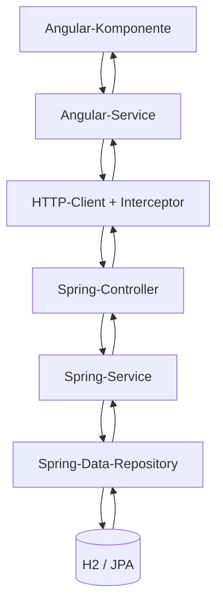
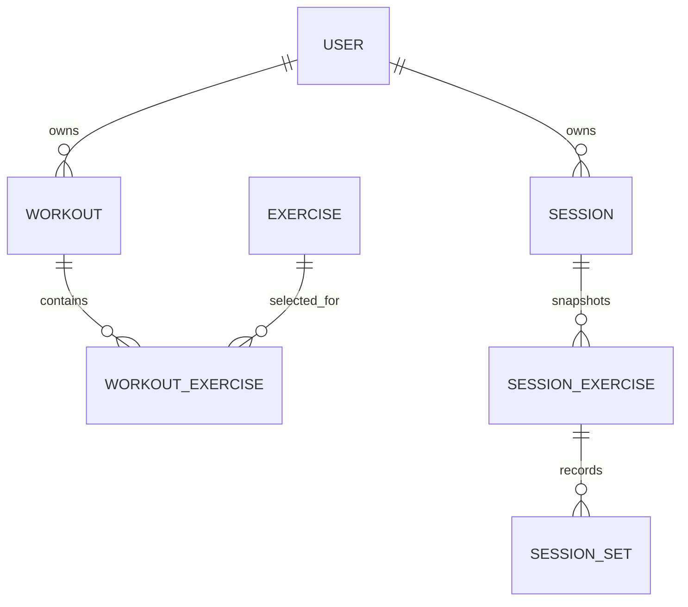

# GymRats – Repository- und Architekturguide

Dieser Guide erklärt, wie GymRats aufgebaut ist, wie die wichtigsten Daten durch das System fließen und welche Dateien du lesen solltest, um den Code eigenständig nachvollziehen zu können. Er beschreibt den Repository-Stand, für den diese Dokumentation erstellt wurde; passe ihn an, wenn sich Architektur oder Verhalten ändern.

## 1. Was ist GymRats?

GymRats ist eine Full-Stack-Anwendung zur Verwaltung von Übungen, Trainingsplänen (Workouts) und absolvierten Trainingseinheiten (Sessions).

Der aktuelle Funktionsumfang umfasst:

- Registrierung und Login mit JWT-basierter Authentifizierung.
- Einen gemeinsamen Übungskatalog mit Muskelgruppen.
- CRUD-Funktionen für eigene Workouts mit geordneten Übungen, Satzvorgaben und Wiederholungsbereichen.
- Start einer Session auf Basis eines Workouts, Eingabe von Gewicht und Wiederholungen sowie Speichern abgeschlossener Trainings.
- Eine Trainingshistorie und Detailansichten vergangener Sessions.

**Fachliche Entscheidung:** Eine Session wird erst beim erfolgreichen Abschließen gespeichert. Das Verwerfen einer laufenden Session navigiert zurück, ohne einen Session-Datensatz anzulegen. Es gibt im aktuellen Modell daher keinen `SessionStatus`.

`Role` kennt `ATHLETE` und `TRAINER`, aber ein vollständiger Trainer-/Athleten-Workflow mit rollenabhängigen Berechtigungen ist in den aktuellen Routen und Endpunkten nicht umgesetzt. Nicht allein aus dem Enum auf fertige Trainerfunktionalität schließen.

## 2. Technologieüberblick

| Bereich | Technologie | Rolle |
|---|---|---|
| Frontend | Angular, TypeScript, Angular Material, SCSS | UI, Routing, Formulare und API-Aufrufe |
| Asynchronität | RxJS | HTTP-Observables und Verarbeitung asynchroner Ergebnisse |
| UI-Zustand | Angular Signals | Lokaler Zustand wie Ladeindikatoren, Fehler und geladene Daten |
| Backend | Java 25, Spring Boot 4.1.1 | REST-API und Geschäftslogik |
| Persistenz | Spring Data JPA / Hibernate | Mapping zwischen Java-Entities und relationalen Tabellen |
| Datenbank | H2 | Lokale Entwicklungs- und E2E-Datenbank |
| Sicherheit | Spring Security, JWT, BCrypt | Authentifizierung und Schutz der API |
| Frontend-Unit-Tests | Vitest, `@vitest/coverage-v8` | Tests isolierter Komponenten, Services und Funktionen |
| Backend-Tests | Spring Boot Test / JUnit | Tests für Services, API-Verhalten und Persistenzverhalten |
| E2E | TestCafe mit Brave | Browserbasierte Prüfung realer Nutzerabläufe |

## 3. Repository auf einen Blick

```text
GymRats/
├── backend/
│   ├── pom.xml
│   └── src/
│       ├── main/java/de/patrickoeder/gymrats/
│       │   ├── config/       # Spring-Konfiguration und Initialisierer
│       │   ├── security/     # JWT-Konfiguration und aktuelle Benutzer-ID
│       │   ├── user/         # Registrierung, Login und Benutzer
│       │   ├── exercise/     # Übungskatalog
│       │   ├── workout/      # Trainingspläne
│       │   ├── session/      # Gespeicherte Trainingseinheiten
│       │   └── web/          # Einheitliche API-Fehlerantworten
│       ├── main/resources/   # application.properties und Profile
│       └── test/java/        # Backend-Tests
└── frontend/gymrats-ui/
    ├── src/app/
    │   ├── core/             # Guards, HTTP-Interceptor und gemeinsame Services
    │   ├── features/         # Auth, Exercises, Workouts und Sessions
    │   ├── layout/           # Header und Footer
    │   ├── pages/            # Übergeordnete Seiten, z. B. Home
    │   ├── shared/           # Wiederverwendbare UI-Komponenten
    │   ├── app.routes.ts     # Routing und Lazy Loading
    │   └── app.config.ts     # Globale Angular-Provider
    ├── e2e/                  # TestCafe-Tests
    ├── .testcaferc.cjs       # TestCafe-Konfiguration
    ├── proxy.conf.json       # /api wird im Dev-Server an Port 8080 weitergeleitet
    └── package.json          # Skripte und Abhängigkeiten
```

## 4. Architekturprinzip: vom UI bis zur Datenbank

### Frontend

- **Komponenten** (`*.ts`, `*.html`, `*.scss`) verwalten Anzeige, Formulare und Benutzeraktionen.
- **Services** kapseln HTTP-Aufrufe. Komponenten sollten nicht selbst URLs oder die Details des HTTP-Clients verwalten.
- **Models** definieren TypeScript-Typen für API-Daten und Formular-/Request-Daten.
- **Mapper** formen UI-Werte in Request-DTOs um. Sie sind besonders wichtig, wenn die Formulardaten anders strukturiert sind als die API.
- **Guards** entscheiden, ob eine Route geöffnet werden darf.
- **HTTP-Interceptor** hängen das JWT an Requests an und behandeln bestimmte `401 Unauthorized`-Antworten.

### Backend

Die fachlichen Bereiche verwenden überwiegend diese Schichten:

1. **Controller**: nimmt HTTP-Requests entgegen, liest Pfadparameter und authentifizierten Benutzer, delegiert an einen Service und bestimmt den HTTP-Status.
2. **Request-/Response-DTOs**: definieren die API-Verträge. Entities werden nicht direkt als API-Antworten ausgegeben.
3. **Service**: enthält fachliche Regeln, Validierung über DTO-Annotations hinaus, Transaktionen und Mapping.
4. **Repository**: kapselt Datenbankzugriffe mit Spring Data JPA.
5. **Entity**: beschreibt persistierte Daten und Beziehungen.

Der typische Pfad lautet:



## 5. Frontend: wo welche Verantwortung liegt

### App-Konfiguration und Routing

- `src/app/app.ts`: Root-Komponente; enthält Header, Footer und den `RouterOutlet`.
- `src/app/app.config.ts`: registriert Router, `HttpClient`, die beiden HTTP-Interceptor und einen App-Initializer, der eine vorhandene Anmeldung wiederherstellt.
- `src/app/app.routes.ts`: Routing. Feature-Seiten werden mit `loadComponent()` lazy geladen. `authGuard` schützt angemeldete Bereiche, `guestGuard` leitet angemeldete Benutzer von Login und Registrierung weg.
- `src/app/core/guards/auth-guard.ts`: prüft `AuthService.currentUser()` und leitet nicht angemeldete Benutzer zu `/login`.
- `src/app/core/guards/guest-guard.ts`: verhindert, dass ein angemeldeter Benutzer Login-/Register-Seiten öffnet.

### Authentifizierung im Frontend

- `features/auth/services/auth-service.ts`: Registrierung, Login, Logout und Wiederherstellung der Session. Der eingeloggte Benutzer wird als Signal gehalten.
- `core/services/token-storage.service.ts`: legt das JWT unter `authToken` in `localStorage` ab und liest beziehungsweise entfernt es.
- `core/interceptors/auth.interceptor.ts`: hängt `Authorization: Bearer <token>` an ausgehende HTTP-Requests an, sofern ein Token existiert.
- `core/interceptors/unauthorized.interceptor.ts`: bei `401` und vorhandenem Token wird der Benutzer abgemeldet und zu `/login` navigiert. Login und `/api/users/me` sind ausgenommen, weil sie eigene Fehlerbehandlung besitzen.

### Fachliche Frontend-Features

| Feature | Wichtige Dateien | Verantwortung |
|---|---|---|
| Exercises | `features/exercise/exercise-list/`, `exercise-form/`, `services/exercise-service.ts` | Übungskatalog anzeigen und verwalten |
| Workouts | `features/workout/workout-list/`, `workout-form/`, `services/workout-service.ts` | Workouts samt Übungsreihenfolge und Trainingsvorgaben verwalten |
| Workout-Mapping | `features/workout/mappers/workout-request-mapper.ts` | Formularwerte prüfen und als `WorkoutRequest` mit Positionen ab 1 aufbauen |
| Session starten | `features/session/session-form/` | Vorschau laden, Trainingssätze erfassen, abschließen oder verwerfen |
| Session-Mapping | `features/session/mappers/session-request-mapper.ts` | Unvollständige Sätze aus dem Request weglassen, verbleibende Sätze fortlaufend nummerieren |
| Session-Historie | `features/session/session-history/` | Gespeicherte Sessions listen |
| Session-Details | `features/session/session-details/` | Persistierte Übungs- und Satzdaten einer Session darstellen |

### Wichtige Formularentscheidung bei Sessions

`SessionForm` arbeitet mit verschachtelten Reactive Forms: Ein äußeres `FormArray` enthält pro Workout-Übung ein inneres `FormArray` mit Satz-Formularen. Ein Satz gilt nur dann als ausgefüllt, wenn Gewicht und Wiederholungen vorhanden und gültig sind. Der Mapper übernimmt nur vollständige Sätze in den Request und nummeriert sie neu. Wenn kein Satz ausgefüllt ist, kann die Session nicht gespeichert werden.

Das Verwerfen einer Session speichert keine Daten. Der Abschluss zeigt dagegen einen Bestätigungsdialog, speichert die fertigen Satzdaten und merkt sich die zurückgegebene Session-ID, um ein doppeltes Speichern zu verhindern.

## 6. Backend: fachliche Bereiche

### `user/` – Registrierung und Login

- `AuthController`: `POST /api/auth/login`.
- `UserController`: `POST /api/users` zum Registrieren und `GET /api/users/me` für den angemeldeten Benutzer.
- `UserService`: normalisiert E-Mail-Adressen (trimmen und lowercase), verhindert doppelte E-Mails, hasht Passwörter mit BCrypt, prüft Login-Daten und stellt ein JWT aus.
- Das JWT enthält die Benutzer-ID als `sub` und läuft nach einer Stunde ab.
- `User` speichert `passwordHash`, niemals das rohe Passwort als Feldwert.

### `exercise/` – Übungskatalog

- `ExerciseController` stellt CRUD-Endpunkte unter `/api/exercises` bereit.
- `ExerciseService` führt Repository-Zugriffe aus und bildet Entities auf DTOs ab.
- `Exercise` enthält Name, Muskelgruppe und Beschreibung. `MuscleGroup` ist ein Enum und wird in der Datenbank als String gespeichert.
- Der Übungskatalog ist im aktuellen Modell global; die Exercise-Entity hat keine Besitzerbeziehung. Die API ist dennoch durch die globale Security-Regel authentifizierungspflichtig.

### `workout/` – Trainingspläne

- `WorkoutController` nimmt Requests unter `/api/workouts` entgegen.
- `WorkoutService` hängt ein neues Workout an den authentifizierten Benutzer, überprüft die Eindeutigkeit der Übungspositionen und baut die `WorkoutExercise`-Beziehungen auf.
- Abfragen, Änderungen und Löschungen verwenden `findByIdAndOwner_Id` beziehungsweise `findAllByOwner_Id`. So wird die Workout-Sicht auf den aktuellen Benutzer begrenzt.
- Die Response sortiert zugehörige Übungen nach `position`.

Ein `Workout` ist der Trainingsplan. `WorkoutExercise` ist die Verknüpfung zwischen Workout und Exercise und enthält die planbezogenen Werte: Position, geplante Satzanzahl, minimale und maximale Wiederholungen.

### `session/` – absolvierte Trainings

Wichtige Controller-Endpunkte:

- `GET /api/sessions/preview/{workoutId}`: erstellt eine Vorschau auf Basis eines eigenen Workouts.
- `POST /api/sessions`: speichert ein abgeschlossenes Training.
- `GET /api/sessions`: listet die Session-Historie des aktuellen Benutzers.
- `GET /api/sessions/{sessionId}`: liefert Details einer eigenen Session.

`SessionService` übernimmt den fachlich wichtigsten Teil des Flows:

1. Er lädt das Workout über ID **und** Besitzer-ID. Ein fremdes Workout ist dadurch nicht verwendbar.
2. Er plausibilisiert `startedAt` und akzeptiert maximal eine Minute Abweichung in die Zukunft; ein knapp zukünftiger Startzeitpunkt wird auf `endedAt` begrenzt.
3. Er ordnet Request-Übungen anhand ihrer Position zu und prüft, ob Übungs-ID und Position zum gespeicherten Workout passen.
4. Er prüft, ob nicht mehr Sätze als geplant gesendet wurden und dass Satznummern lückenlos bei 1 beginnen.
5. Er verlangt mindestens einen ausgefüllten Satz und speichert dann Session, Übungs-Snapshots und Sätze in einer Transaktion.

### Warum speichert die Session Übungsdaten als Snapshot?

`Session` speichert `sourceWorkoutId` und `workoutName` als Werte. `SessionExercise` speichert unter anderem `sourceExerciseId`, `exerciseName`, `muscleGroup` und die damaligen Trainingsvorgaben als Werte statt als JPA-Beziehungen zu `Workout` oder `Exercise`.

Dadurch enthält die Historie eine Momentaufnahme des damaligen Trainings. Wird ein Workout oder eine Übung später umbenannt oder geändert, hängen die historischen Session-Anzeigen nicht vollständig von den aktuellen Stammdaten ab.

### Datenmodell im Überblick



`sourceWorkoutId` in `Session` und `sourceExerciseId` in `SessionExercise` sind im aktuellen Code UUID-Felder und keine JPA-Fremdschlüsselbeziehungen.

## 7. API-Referenz

Alle folgenden Endpunkte sind relativ zum Backend unter `http://localhost:8080`. Außer Registrierung und Login erfordert die API ein gültiges Bearer-Token. Die genaue Validierung steht in den Request-DTOs und den jeweiligen Services.

| Methode | Pfad | Zweck | Authentifizierung |
|---|---|---|---|
| `POST` | `/api/users` | Benutzer registrieren | öffentlich |
| `POST` | `/api/auth/login` | Anmelden und JWT erhalten | öffentlich |
| `GET` | `/api/users/me` | aktuellen Benutzer laden | erforderlich |
| `GET` | `/api/exercises` | Übungen auflisten | erforderlich |
| `GET` | `/api/exercises/{id}` | Übung laden | erforderlich |
| `POST` | `/api/exercises` | Übung erstellen | erforderlich |
| `PUT` | `/api/exercises/{id}` | Übung aktualisieren | erforderlich |
| `DELETE` | `/api/exercises/{id}` | Übung löschen | erforderlich |
| `GET` | `/api/workouts` | eigene Workouts auflisten | erforderlich |
| `GET` | `/api/workouts/{id}` | eigenes Workout laden | erforderlich |
| `POST` | `/api/workouts` | Workout erstellen | erforderlich |
| `PUT` | `/api/workouts/{id}` | eigenes Workout ersetzen/aktualisieren | erforderlich |
| `DELETE` | `/api/workouts/{id}` | eigenes Workout löschen | erforderlich |
| `GET` | `/api/sessions/preview/{workoutId}` | Session-Vorschau laden | erforderlich |
| `POST` | `/api/sessions` | abgeschlossene Session speichern | erforderlich |
| `GET` | `/api/sessions` | eigene Session-Historie laden | erforderlich |
| `GET` | `/api/sessions/{sessionId}` | eigene Session-Details laden | erforderlich |

`ApiExceptionHandler` vereinheitlicht Fehlerantworten im `ProblemDetail`-Format. Bean-Validation-Fehler liefern HTTP 400 einschließlich einer `errors`-Property. Datenintegritätsverletzungen werden als HTTP 409 dargestellt. Nicht gefundene beziehungsweise ungültige Ressourcen werden unter anderem über `ResponseStatusException` behandelt.

## 8. Konfiguration und lokaler Start

### Voraussetzungen

- Node.js und npm passend zu den installierten Angular-Abhängigkeiten.
- JDK 25 (in `backend/pom.xml` ist `java.version` auf 25 gesetzt).
- Maven; alternativ den mitgelieferten Maven Wrapper `./mvnw`.
- Brave für die aktuelle TestCafe-Konfiguration. Der Browserpfad steht in `frontend/gymrats-ui/.testcaferc.cjs` und muss auf anderen Systemen gegebenenfalls geändert werden.

### JWT-Secret setzen

`gymrats.jwt.secret` wird über die Umgebungsvariable `GYMRATS_JWT_SECRET` gesetzt. `JwtProperties` verlangt mindestens 32 UTF-8-Bytes. Beispiel für eine lokale Shell:

```bash
export GYMRATS_JWT_SECRET="$(openssl rand -base64 32)"
```

Das Secret nicht committen oder in README/Properties-Dateien eintragen. Wenn du ein neues Secret generierst, werden zuvor ausgegebene Tokens mit dem alten Secret nicht mehr validiert.

### Entwicklungsbackend starten

Terminal 1:

```bash
cd backend
export GYMRATS_JWT_SECRET="$(openssl rand -base64 32)"
./mvnw spring-boot:run -Dspring-boot.run.profiles=dev
```

- Standard-Port: `8080`.
- Persistente H2-Datenbank: `jdbc:h2:file:./data/gymrats` relativ zum Backend-Arbeitsverzeichnis.
- H2-Console im `dev`-Profil: `http://localhost:8080/h2-console`.
- `application-dev.properties` ergänzt die Basiskonfiguration um die H2-Console. `H2ConsoleSecurityConfig` gilt nur im Profil `dev`.

### Entwicklungsfrontend starten

Terminal 2:

```bash
cd frontend/gymrats-ui
npm install
npm start
```

- Frontend: `http://localhost:4200`.
- `proxy.conf.json` leitet `/api/**` an `http://localhost:8080` weiter. Daher verwenden Angular-Services relative URLs wie `/api/workouts`.

### E2E-Backend starten

In einem eigenen Terminal mit separater Umgebung:

```bash
cd backend
export GYMRATS_JWT_SECRET="$(openssl rand -base64 32)"
./mvnw spring-boot:run -Dspring-boot.run.profiles=e2e
```

`application-e2e.properties` verwendet `jdbc:h2:mem:gymrats-e2e;DB_CLOSE_DELAY=-1`, `ddl-auto=create-drop`, deaktiviert die H2-Console und bindet den Server an `127.0.0.1`. Die Datenbankdatei der Entwicklung wird damit nicht verwendet. Beim Beenden des Backend-Prozesses gehen die E2E-Daten verloren; bei einem neuen Prozess startet die In-Memory-Datenbank leer.

`DataInitializer` erzeugt den Demo-Benutzer nur in `dev` und `e2e`; `ExerciseDataInitializer` fügt vorhandene Standardübungen hinzu, falls sie noch nicht existieren. Demo-Zugangsdaten aus dem Initializer ausschließlich lokal verwenden, niemals für eine öffentliche Produktionsinstanz.

## 9. Tests und Qualitätschecks

### Frontend-Unit-Tests und Coverage

Im Verzeichnis `frontend/gymrats-ui`:

```bash
npm run lint
npm test -- --watch=false
npm test -- --coverage --no-watch
npm run build
```

- Unit-Tests liegen neben den zugehörigen Klassen als `*.spec.ts`.
- Vitest ist der Test-Runner; `@vitest/coverage-v8` erzeugt die Coverage-Berichte.
- Angular Templates werden über die ESLint-Konfiguration ebenfalls geprüft.

### Backend-Tests

Im Verzeichnis `backend`:

```bash
./mvnw test
```

Wichtige Testbereiche:

- `session/SessionServiceTest.java`: Validierung und Aufbau gespeicherter Session-Daten.
- `web/ApiErrorHandlingTest.java`: Authentifizierung, Validation, Konflikte und API-Fehlerformat.
- `security/JwtPropertiesTest.java`: Mindestlänge und fehlendes JWT-Secret.
- `persistence/QueryCountTest.java`: Query-Anzahl für Listen- und Detailabfragen.
- `GymratsApplicationTests.java`: grundlegender Context-Start.

### E2E mit TestCafe

Die Tests liegen unter `frontend/gymrats-ui/e2e/`:

- `auth.test.js`: Login über den Browser.
- `workout.test.js`: Workout erstellen, bearbeiten und löschen.
- `session.test.js`: Workout anlegen, Session ausfüllen, speichern und die Session-Historie/Details überprüfen.

Die aktuelle Konfiguration liegt in `.testcaferc.cjs`; der Browserpfad ist derzeit auf `/usr/bin/brave-browser` gesetzt. Im Verzeichnis `frontend/gymrats-ui`:

```bash
npm run test:e2e
```

Backend (Profil `e2e`) und Frontend müssen vorher laufen. E2E-Tests schreiben in die separate In-Memory-Datenbank. Der aktuelle Testcode löscht angelegte Daten nicht in einem `finally`-Block; bei einem fehlgeschlagenen Test können bis zum Backend-Neustart Datensätze verbleiben. Zeitstempel in Testnamen verhindern Namenskollisionen, ersetzen aber keine Bereinigung.

## 10. Ein sinnvoller Lesepfad zum Lernen

Wenn du das Repository Schritt für Schritt verstehen willst, lies den Code nicht zufällig, sondern verfolge konkrete Anwendungsfälle von außen nach innen.

### Lesepfad A: Login

1. `frontend/gymrats-ui/src/app/app.routes.ts` – welche Route wird geladen?
2. `features/auth/login/login.ts` und `login.html` – was macht die Oberfläche?
3. `features/auth/services/auth-service.ts` – wie wird der Login-Request gesendet und der Benutzerzustand aktualisiert?
4. `core/interceptors/auth.interceptor.ts` und `token-storage.service.ts` – wie werden Token gespeichert und verschickt?
5. `backend/.../user/AuthController.java` – wo landet der Request?
6. `backend/.../user/UserService.java` – wie werden Passwort geprüft und JWT erzeugt?
7. `backend/.../config/SecurityConfig.java` und `security/JwtConfig.java` – wie wird das Token später validiert?

### Lesepfad B: Workout erstellen

1. `workout-form/workout-form.html` – welche Werte gibt der Benutzer ein?
2. `workout-form/workout-form.ts` – Reactive Forms, Validierung und Submit-Verhalten.
3. `workout/mappers/workout-request-mapper.ts` – wie werden Form-Werte in einen API-Request umgebaut?
4. `workout/services/workout-service.ts` – HTTP-Aufruf.
5. `WorkoutController.java` – Authentifizierungsinformationen und Request entgegennehmen.
6. `WorkoutService.java` – Besitzer prüfen, Positionen validieren, Entity-Graph aufbauen und speichern.
7. `Workout`, `WorkoutExercise` und `WorkoutRepository` – Persistenzmodell und Abfragen.

### Lesepfad C: Session speichern

1. `session-form/session-form.ts` – Session laden, Sätze validieren und speichern/verwerfen.
2. `session-request-mapper.ts` – nur vollständige Sätze in das Request-Objekt übernehmen und neu nummerieren.
3. `session/services/session-service.ts` – API-Aufrufe.
4. `SessionController.java` – Endpunkte und aktuellen Benutzer.
5. `SessionService.java` – fachliche Validierung und Erzeugung der Snapshot-Entities.
6. `Session`, `SessionExercise`, `SessionSet` – wie die abgeschlossene Trainingseinheit gespeichert wird.
7. `SessionHistory` und `SessionDetails` – wie die gespeicherten Daten wieder gelesen und angezeigt werden.
8. `e2e/session.test.js` – der gesamte Ablauf aus Sicht eines Benutzers.

### Fragen, die du nach jedem Lesepfad beantworten können solltest

- Welche Komponente startet den Ablauf?
- Welche Datenstruktur kommt aus dem Formular und welche wird an die API gesendet?
- Wo wird fachlich validiert – im Frontend, Backend oder an beiden Stellen?
- Wo wird die aktuelle Benutzer-ID ermittelt und verwendet?
- Welche Klasse ist für das Persistieren zuständig?
- Wie sieht der Fehlerpfad aus, und wie wird er in der Oberfläche dargestellt?
- Welcher Test deckt diesen Ablauf oder seine wichtigsten Regeln ab?

Wenn du diese Fragen für Login, Workout und Session beantworten kannst, hast du die zentralen Architektur- und Datenflüsse von GymRats verstanden.
