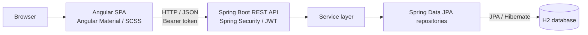
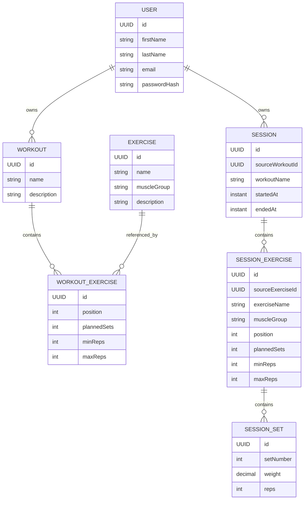

# Architecture

This document describes the architecture implemented in the current repository snapshot.

## System overview

GymRats is split into an Angular single-page application and a Spring Boot REST API. The frontend communicates with the backend using JSON over HTTP.



In development, the Angular CLI dev server runs on port `4200` and proxies `/api/**` to the backend on port `8080`. The proxy is configured in `frontend/gymrats-ui/proxy.conf.json` and is enabled by the development serve configuration.

## Frontend

The frontend is an Angular application using standalone components and lazy-loaded feature routes.

- `core/` contains cross-cutting services, route guards, token storage, and HTTP interceptors.
- `features/auth/` contains registration, login, authentication models, and the authentication service.
- `features/exercise/` contains exercise listing, editing, models, and API access.
- `features/workout/` contains workout listing, creation/editing, drag-and-drop ordering, models, and API access.
- `features/session/` contains session preparation, data entry, history, details, models, and request mapping.
- `layout/` contains the shared header and footer.
- `shared/` contains reusable UI components and shared styles.

The `authGuard` protects the authenticated application routes. The `guestGuard` prevents authenticated users from opening the login and registration routes. The authentication interceptor attaches the stored access token to API requests; the unauthorized interceptor handles unauthorized responses. The application initializer attempts to restore the current user session when the app starts.

Angular Material provides UI components, Angular CDK provides drag-and-drop, and SCSS is used for styling.

## Backend

The backend follows a conventional layered Spring architecture, organised by feature:

- **Controllers** expose REST endpoints and obtain the authenticated user identity where required.
- **Services** implement business rules and coordinate persistence.
- **Repositories** use Spring Data JPA for database access.
- **Entities** represent persisted domain objects.
- **DTOs** define API request and response payloads.

The main feature packages are `user`, `exercise`, `workout`, and `session`. Shared configuration, JWT security, and API exception handling live in `config`, `security`, and `web`.

## Authentication and authorization

The API is stateless and uses signed JWT bearer tokens. Registration (`POST /api/users`) and login (`POST /api/auth/login`) are public. All other API requests require a valid bearer token.

Passwords are encoded with BCrypt. The JWT contains the user's UUID as its subject and expires after one hour. The JWT signing secret is supplied through `GYMRATS_JWT_SECRET`; the application validates that it contains at least 32 bytes.

Workout and session queries are scoped to the authenticated user. The exercise catalogue is shared: exercise endpoints require authentication, but exercises are not associated with an individual account.

## Data model



### Important data-model details

- A `Workout` belongs to one `User` and contains ordered `WorkoutExercise` entries.
- Each `WorkoutExercise` references an entry in the shared `Exercise` catalogue and stores workout-specific planning data: position, planned sets, and minimum/maximum repetitions.
- A `Session` belongs to one `User`. It stores the source workout ID and workout name as values, rather than maintaining a JPA relationship to the source workout.
- `SessionExercise` stores a snapshot of exercise details and planning values at the time the session is saved. This keeps the history display independent of later changes to the exercise catalogue or workout plan.
- Each `SessionExercise` contains zero or more `SessionSet` records. Each saved set stores its set number, weight, and repetitions.

## Session lifecycle and persistence

The session preview endpoint (`GET /api/sessions/preview/{workoutId}`) provides the workout data needed to prepare a session. While the user is training, entered values remain in frontend form state; no session record is created yet.

When the user finishes and saves the session, the frontend sends `POST /api/sessions`. The backend validates the submitted exercises and sets against the source workout, then persists the session with its start and end timestamps. The session history therefore contains saved training sessions only.

Discarding a session navigates away from the form without calling the create endpoint, so the entered values are not persisted and no history entry is created. The data model intentionally has no session status field. The previous two-status approach was removed during refactoring because the status values could become inconsistent during saving. Persistence is now the single source of truth: a stored session represents a finished, saved training session.

## Database configuration

The default configuration uses a file-based H2 database:

```properties
spring.datasource.url=jdbc:h2:file:./data/gymrats
spring.jpa.hibernate.ddl-auto=update
```

The `dev` profile enables the H2 web console at `/h2-console`. The `e2e` profile switches to an isolated in-memory database and uses `create-drop` schema management.

The exercise data initializer inserts a predefined set of exercises when they do not already exist. A separate initializer creates the local test user only under the `dev` and `e2e` profiles.

## Error handling

The API centralises exception handling in `ApiExceptionHandler`. Validation failures include field-level details in an RFC 9457 `ProblemDetail` response. Common error cases include invalid input (`400`), missing or inaccessible resources (`404`), unauthenticated requests (`401`), and data-integrity conflicts (`409`).
